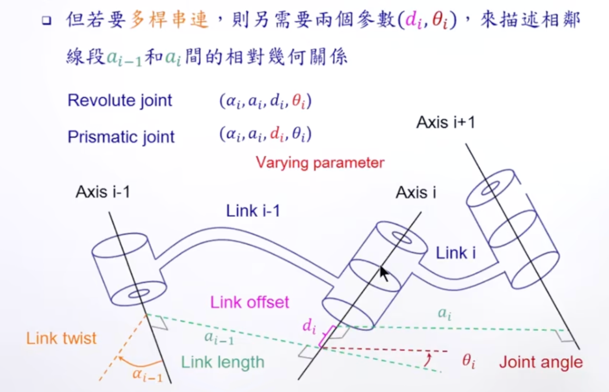
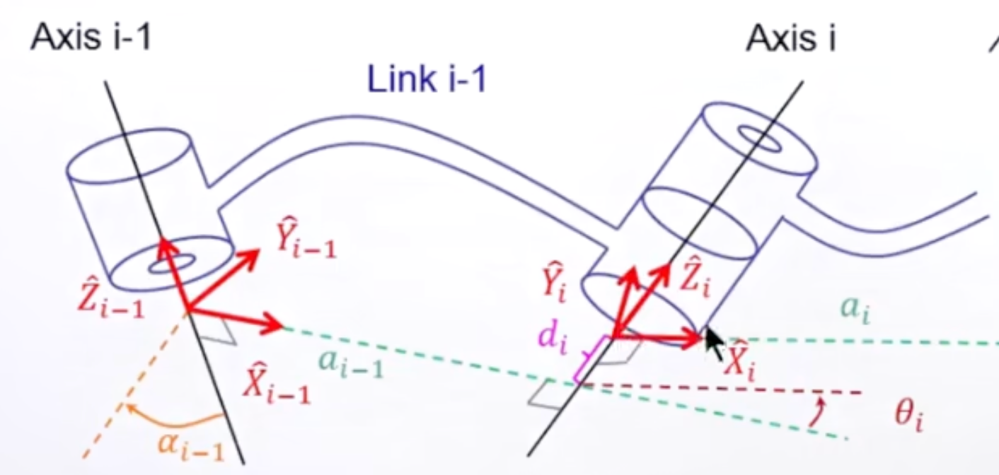
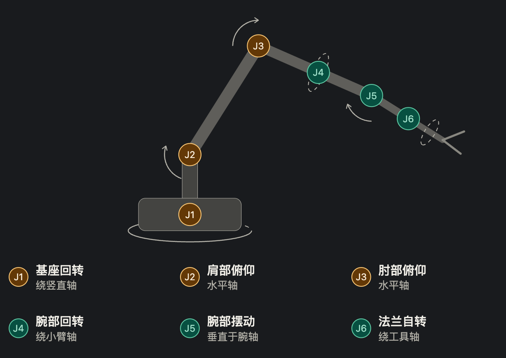

#### 1. 简介

正运动学 (Forward Kinematics) 解决的问题是：已知所有关节角度，计算机器人末端执行器的位姿。Denavit-Hartenberg (DH) 参数法是建立连杆坐标系的标准方法。

#### 2. DH 参数详解 (标准型)

描述相邻两个连杆 $i-1$ 和 $i$ 之间的关系，仅需 4 个参数：

| **参数**     | **符号**   | **物理含义**                                      | **测量基准**      |
| ------------ | ---------- | ------------------------------------------------- | ----------------- |
| **连杆长度** | $a_i$      | 沿 $x_i$ 轴，从 $z_{i-1}$ 到 $z_i$ 的距离         | 连杆本身结构      |
| **连杆扭角** | $\alpha_i$ | 绕 $x_i$ 轴，从 $z_{i-1}$ 旋转到 $z_i$ 的角度     | 连杆本身结构      |
| **关节偏距** | $d_i$      | 沿 $z_{i-1}$ 轴，从 $x_{i-1}$ 到 $x_i$ 的距离     | 关节变量 (移动副) |
| **关节角度** | $\theta_i$ | 绕 $z_{i-1}$ 轴，从 $x_{i-1}$ 旋转到 $x_i$ 的角度 | 关节变量 (旋转副) |

相邻连杆的变换矩阵 $T_{i-1}^{i}$ 公式为：

$$T_{i-1}^{i} = \text{Rot}_{z}(\theta_i) \cdot \text{Trans}_{z}(d_i) \cdot \text{Trans}_{x}(a_i) \cdot \text{Rot}_{x}(\alpha_i)$$




视频参考：【【机械臂运动学教程】机械臂+旋转矩阵+变换矩阵+DH+逆解+轨迹规划+机器人+教程】 https://www.bilibili.com/video/BV1oa4y1v7TY/?p=4&share_source=copy_web&vd_source=7c81b2f4b5ca1fd1f99a735ccfc9be99

#### 3. 架构流程 (Mermaid)

```Mermaid
graph TD
    Input[输入: 关节角度 q1, q2, ..., qn] --> Step1[建立DH参数表]
    Step1 --> Step2[计算每个连杆的变换矩阵 T_01, T_12...]
    Step2 --> Step3[链式乘法 T_total = T_01 * T_12 * ...]
    Step3 --> Output[输出: 末端位姿 T_0n]
```

#### 4. Python 代码验证

以下代码实现了一个通用的 DH 矩阵生成器，并验证了一个简单的 2连杆平面机械臂 (2-Link Planar Arm)。


```Python
import numpy as np

def dh_matrix(theta, d, a, alpha):
    """
    根据标准DH参数计算变换矩阵 T_{i-1, i}
    单位: 角度使用弧度, 长度使用米
    """
    ct, st = np.cos(theta), np.sin(theta)
    ca, sa = np.cos(alpha), np.sin(alpha)
    
    return np.array([
        [ct, -st*ca,  st*sa, a*ct],
        [st,  ct*ca, -ct*sa, a*st],
        [0,   sa,     ca,    d   ],
        [0,   0,      0,     1   ]
    ])

def forward_kinematics_2link(joint_angles, link_lengths):
    """
    计算2连杆平面机械臂的末端位置
    """
    theta1, theta2 = joint_angles
    L1, L2 = link_lengths
    
    # 连杆 1: frame 0 -> frame 1
    # theta=q1, d=0, a=L1, alpha=0
    T_01 = dh_matrix(theta1, 0, L1, 0)
    
    # 连杆 2: frame 1 -> frame 2
    # theta=q2, d=0, a=L2, alpha=0
    T_12 = dh_matrix(theta2, 0, L2, 0)
    
    # 总变换矩阵
    T_02 = T_01 @ T_12
    
    return T_02

# --- 验证 ---
# 设定: L1=1m, L2=1m
# 情况 1: q1=0, q2=0 -> 手臂伸直横在X轴 -> 末端应为 (2, 0, 0)
# 情况 2: q1=90度, q2=0 -> 手臂垂直指天 -> 末端应为 (0, 2, 0)
# 情况 3: q1=0, q2=90度 -> 第一段横着，第二段向上 -> 末端应为 (1, 1, 0)

L_params = [1.0, 1.0]
q_case3 = [0, np.radians(90)] 

T_final = forward_kinematics_2link(q_case3, L_params)
pos_final = T_final[:3, 3]

print(f"关节角: {np.degrees(q_case3)}")
print(f"计算出的末端位置 (x, y, z): {np.round(pos_final, 4)}")
# 预期输出: x=1.0, y=1.0, z=0.0
```

#### 5. 实战练习：UR5 六自由度机械臂正运动学

UR5 是工业界最经典的 6 自由度协作机器人。下面使用与第 2 节一致的**标准 DH** 参数（注意：不同厂商或文献可能使用改进型 DH，即 MDH），套用上面的 `dh_matrix` 求解其零位末端坐标。



**单位：** $d, a$ (毫米 mm), $\alpha, \theta$ (弧度 rad)

| **关节 Joint (i)** | **αi (Twist)** | **ai (Link Length)** | **di (Link Offset)** | **θi (Range)** |
| ------------------ | -------------- | -------------------- | -------------------- | -------------- |
| **1 (Base)**       | $\pi/2$        | 0                    | 89.16                | $q_1$          |
| **2 (Shoulder)**   | 0              | -425.00              | 0                    | $q_2$          |
| **3 (Elbow)**      | 0              | -392.25              | 0                    | $q_3$          |
| **4 (Wrist 1)**    | $\pi/2$        | 0                    | 109.15               | $q_4$          |
| **5 (Wrist 2)**    | $-\pi/2$       | 0                    | 94.65                | $q_5$          |
| **6 (Wrist 3)**    | 0              | 0                    | 82.30                | $q_6$          |

```Python
def forward_kinematics(dh_params, joint_angles):
    """
    通用正运动学: 根据标准DH参数表计算末端执行器位姿 T_0n。
    dh_params: 列表, 每个元素为 (alpha, a, d)
    joint_angles: 各旋转关节的角度 theta (列表), 与 dh_params 一一对应
    """
    T = np.eye(4)
    for (alpha, a, d), theta in zip(dh_params, joint_angles):
        T = T @ dh_matrix(theta, d, a, alpha)
    return T

# --- UR5 标准DH参数 ---
# 每个元素顺序: (alpha, a, d)
ur5_dh = [
    ( np.pi/2,      0.0,  89.16),  # 关节1 (Base)
    ( 0.0,       -425.0,   0.0 ),  # 关节2 (Shoulder)
    ( 0.0,       -392.25,  0.0 ),  # 关节3 (Elbow)
    ( np.pi/2,      0.0, 109.15),  # 关节4 (Wrist 1)
    (-np.pi/2,      0.0,  94.65),  # 关节5 (Wrist 2)
    ( 0.0,          0.0,  82.30),  # 关节6 (Wrist 3)
]

# 零位: q = [0, 0, 0, 0, 0, 0]
q_zero = [0, 0, 0, 0, 0, 0]

T_06 = forward_kinematics(ur5_dh, q_zero)
pos_zero = T_06[:3, 3]

print(f"UR5 零位末端坐标 (x, y, z) mm: {np.round(pos_zero, 2)}")
# 预期输出: x=-817.25, y=-191.45, z=-5.49
```

