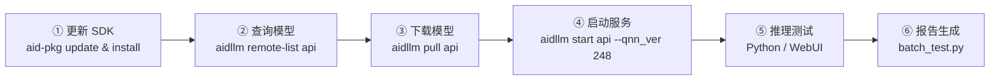

<!-- Generated by the offline translation workflow.
Source: 03-机器人硬件、lerobot及地瓜RDK-X5开发板控制教程/11犀牛派X1部署VLM方法.md
Source SHA-256: 66301db0c931f6e7194500305f4ff0f9f5c48814db0c7cb226ed6639461fb147
Model: tencent/Hy-MT2-1.8B-GGUF:Q4_K_M
Review machine-translated technical claims before relying on them.
-->
# Deploying Qwen3-VL-8B on Rhino Pi-X1: From SDK Update to Actual Performance

> This article comprehensively records the entire process of deploying the **Qwen3-VL-8B** vision-language model (VLM) on the APLUX Rhino Pi-X1 edge computing board, based on the AidGenSE inference engine: updating the SDK → querying and downloading the model → starting the OpenAI-compatible inference service → actual image inference testing. At the end, the testing results and summary of challenges are provided for developers engaged in on-device multimodal deployment to refer to.

**TL;DR：**

- Board: Rhino Pi-X1 (Qualcomm QCS8550), system: Ubuntu 22.04 (AidLux)
- Model: `qwen3-vl-8b-instruct-qnn2.48-w4a16-qcs8550` (QNN 2.48 / W4A16 quantization, ~5.2 GB)
- **Big issue**: When starting the service, the QNN version must match that of the model (`--qnn_ver 248`); otherwise, the service will remain stuck at `Api server starting...`.
- **Actual performance**: Five images from different scenes can be accurately recognized and described fluently (see "Actual Performance" at the end of the article).

## 1. Background

Deploying a vision-language model (VLM) on the edge can perform tasks such as image understanding and text-image Q&A without any data leaving the device or network latency. This is highly suitable for scenarios like industrial quality inspection, smart cameras, and offline assistants. AidGenSE is a generative AI inference engine provided by APLUX, which supports deploying quantized multimodal large models into edge boards in the form of **OpenAI-compatible HTTP services**.

This article refers to the official tutorial "Using AidGen to Deploy VLM", and deploys a 8B-level Qwen3-VL-8B model on Rhino Pi-X1, and measures its image understanding performance.

## II. Environment Information

| Item | Description |
| --- | --- |
| Device | Rhino Pi-X1 |
| Chip Platform | Qualcomm QCS8550 (`qc8550 enterprise`) |
| System | Ubuntu 22.04.2 LTS (AidLux / linux edition, ROOTFS 50) |
| CPU Architecture | aarch64 (kernel 5.15.148) |
| Inference Engine | AidGenSE 3.3.1 |
| SDK Version | aidgen-sdk 2.4.3.166 / aidgen-qnn248 2.4.3.166 |
| Model | qwen3-vl-8b-instruct-qnn2.48-w4a16-qcs8550 |
| Service Port | 8888 (OpenAI-compatible API) |

## III. Overview of Deployment Process



## IV. Step 1: Update and install the SDK

> **Why must the SDK be updated first?** The AidGen model is tightly bound to the SDK/QNN version. When the pre-installed SDK on the board is outdated, `aidllm` may not be able to query or run new models. Therefore, the first step is to update the software package index and install the latest components.

```bash
# 1. 更新软件包索引
sudo aid-pkg update

# 2. 安装 AidGenSE（生成式 AI 推理引擎服务）
sudo aid-pkg -i aidgense

# 3. 安装 AidGen SDK 与各版本 QNN 运行时
sudo aid-pkg -i aidgen-sdk
sudo aid-pkg -i aidgen-qnn236
sudo aid-pkg -i aidgen-qnn240
sudo aid-pkg -i aidgen-qnn248
```

Two easy-to-miss details:

1. `aid-pkg -i` **only one package can be installed at a time**. Writing it as `sudo aid-pkg -i a b c` will trigger `Please enter the correct parameter`;
2. During the installation process, dependencies (such as `aidgen-sdk`, `aidlms-sdk`, and `aidlux-aistack-base`) will be checked, and `[y/n]` will be asked interactively. Just confirm according to the prompts.

Key version after this installation:

| Package | Version |
| --- | --- |
| aidgense | 3.3.1 |
| aidgen-sdk | 2.4.3.166 |
| aidgen-qnn240 | 2.4.3.166 |
| aidgen-qnn248 | 2.4.3.166 |
| aidgen-qnn236 | 2.4.0.139 |

## 5. Step 2: Query and Download Models

```bash
# 查看当前支持的全部模型（自动按板卡 SoC 过滤）
aidllm remote-list api
```

Output example (filtered for QCS8550):

```text
socfg:  { qc8550 enterprise}
Current Soc :  8550

qwen3-vl-8b-instruct-qnn2.48-w4a16-qcs8550            VLM     2026-08-13 17:55:43
qwen3-vl-4b-instruct-448x448-qnn2.40-w4a16-qcs8550    VLM     2026-08-13 17:55:59
qwen2.5-vl-3b-instruct-392x392-qnn2.36-w4a16-qcs8550  VLM     2026-08-13 17:55:59
...
```

The model naming rules can be divided into four sections (don't mix up the letters when downloading and starting):

| Segment | Meaning |
| --- | --- |
| `qwen3-vl-8b-instruct` | Model name and specifications |
| `qnn2.48` | Dependent QNN runtime version (**determines `--qnn_ver` at startup**) |
| `w4a16` | Quantization method (weights 4 bits / activations 16 bits) |
| `qcs8550` | Target chip platform |

Then download and confirm:

```bash
# 下载模型（约 5.2 GB）
aidllm pull api qwen3-vl-8b-instruct-qnn2.48-w4a16-qcs8550

# 查看本地已下载模型
aidllm list api
```

## VI. Step 3: Start the inference service (Key: QNN version must match)

First, look at the **mistake-making scene** — start it directly according to intuition:

```bash
aidllm start api -m qwen3-vl-8b-instruct-qnn2.48-w4a16-qcs8550
```

The logs cycle repeatedly, and the service never starts:

```text
Use model:  qwen3-vl-8b-instruct-qnn2.48-w4a16-qcs8550
Processor:  dsp
args : [--device dsp --qnn_ver 240]        # ← 注意这里
Api server starting...
Api server starting...
Api server starting...
...
```

The reason lies in `--qnn_ver 240`: the `aidllm start api`'s `--qnn_ver` **default value is 240**, and this model is compiled with **QNN 2.48**. After explicitly specifying the version, the service starts successfully on the first attempt:

```bash
aidllm start api \
  -m qwen3-vl-8b-instruct-qnn2.48-w4a16-qcs8550 \
  -d dsp \
  --qnn_ver 248
```

```text
Use model:  qwen3-vl-8b-instruct-qnn2.48-w4a16-qcs8550
Processor:  dsp
args : [--device dsp --qnn_ver 248]
Api server start successfully.
```

> Experience tip: **`qnn2.xx` in the model name is the value that `--qnn_ver` should be filled with** (236 / 240 / 248).

Verify service status:

```bash
curl -s http://127.0.0.1:8888/v1/models
```

```json
{
    "object": "list",
    "loaded_id": "qwen3-vl-8b-instruct-qnn2.48-w4a16-qcs8550",
    "model_type": "vlm",
    "data": [
        { "id": "qwen3-vl-8b-instruct-qnn2.48-w4a16-qcs8550", "object": "model", "owned_by": "aplux" }
    ]
}
```

The service port is **8888** by default. Common management commands:

```bash
aidllm status api     # 查看状态
aidllm restart api    # 重启
aidllm stop api       # 停止
```

(Optional) If you want to quickly experience the conversation via a web interface:

```bash
sudo aidllm install ui
aidllm start ui       # 浏览器访问 http://<板卡IP>:51104
```

## VII. Step 4: Image Reasoning Test

### 7.1 Single Image Dialogue (Python)

Key points: The `data URL` that converts images to base64, sent in the OpenAI multimodal message format `image_url`, and parsed as an SSE streaming response:

```python
import base64, json, requests

def run(image_path: str, prompt: str = "描述这张图片的内容。"):
    with open(image_path, "rb") as f:
        b64 = base64.b64encode(f.read()).decode()
    messages = [
        {"role": "system", "content": "You are a helpful assistant."},
        {"role": "user", "content": [
            {"type": "text", "text": prompt},
            {"type": "image_url", "image_url": {"url": f"data:image/png;base64,{b64}"}},
        ]},
    ]
    r = requests.post(
        "http://127.0.0.1:8888/v1/chat/completions",
        json={"model": "qwen3-vl-8b-instruct-qnn2.48-w4a16-qcs8550",
              "messages": messages, "stream": True},
        stream=True,
    )
    for line in r.iter_lines():
        if line and line.startswith(b"data: "):
            data = line[6:].decode()
            if data.strip() == "[DONE]":
                break
            content = json.loads(data)["choices"][0]["delta"].get("content")
            if content:
                print(content, end="", flush=True)
```

### 7.2 Batch test script (batch_test.py)

For convenient batch verification, write `batch_test.py`: automatically traverse the image directory, call the model for each image, and summarize the model responses for each image into a Markdown report:

```bash
python3 assets/rhino_x1/scripts/batch_test.py \
  --images-dir assets/rhino_x1 \
  --model qwen3-vl-8b-instruct-qnn2.48-w4a16-qcs8550 \
  --url http://127.0.0.1:8888/v1/chat/completions \
  --output README_timing.md
```

Output:

- `README_timing.md`: Summary report (including the full text of the model responses for each image)
- `assets/rhino_x1/scripts/batch_timing.json`: Test raw data

## VIII. Actual Performance

After deployment, use 5 images from different scenarios to test the model's visual understanding ability. Use the same prompt: "Describe the content of this image." Here is the actual response from the model.

### 1. Surfing

<p align="center">
  
</p>

> This image shows a surfer riding a spectacular wave. In the picture, the surfer is wearing dark surfing attire, standing on the crest of the wave with his legs slightly bent and body leaning forward. His left hand hangs naturally, while his right hand is raised to maintain balance. He faces forward, and the surfboard beneath him glides steadily in the waves, showing a relaxed and confident posture. The background is a vast blue ocean, with a light blue sky in the distance dotted with a few white clouds. The waves are powerful, and the huge crests emit white foam under the sunlight, creating a stunning sight. A small cloud can be seen above the right side of the image, adding depth to the scene. The entire picture is full of energy and strength, highlighting the appeal and excitement of surfing. The surfer handles the massive wave calmly, demonstrating excellent skill and courage. There are no other people or objects in the frame, only the surfer and the turbulent waves. This scene was clearly captured at sea, perhaps as the surfer enjoys surfing or participating in a surfing activity. The whole image conveys a sense of freedom, passion, and adventure. Overall, this is a dynamic surfing photo that showcases the brave posture of the surfer before a huge wave.……

### 2. Retro Bicycle

<p align="center">
  
</p>

> This image shows a light green vintage bicycle parked in front of a red brick wall. There is a rattan basket at the front of the bike, and the seat is made of brown leather. The frame is slender and elegant, giving the whole scene a peaceful and nostalgic feel. The composition is simple: the bicycle is positioned slightly to the right of the center, with the red brick wall in the background. The bricks are neatly arranged, with a classic reddish-brown color; the corners show some wear and trace of time. The ground is a gray stone path with clear edges and a distinct texture, adding a vintage touch to the image. The overall tone is soft, with a subtle retro filter effect, creating a quiet and warm atmosphere, as if it were a peaceful afternoon spent alone in tranquility. This is a poetic street still life photograph that conveys a sense of leisure and nostalgia through the combination of the bicycle and the brick wall.

### 3. Apples after the Rain

<p align="center">
  
</p>

> This image shows a close-up shot of a red apple hanging on a branch, with a blurred autumn forest background.  - **Subject**: A plump red apple covered in crystal-clear droplets, as if it just rained. The shine and texture of the apple are clearly visible, indicating a fresh and full state.  - **Background**: The background is blurred, showing indistinct trees and yellow-brown fallen leaves, creating an autumn atmosphere. Based on the color and shape, this might be part of an apple tree or a section of an autumn orchard.  - **Composition**: The apple is located in the lower right corner of the frame, occupying the visual center. The branches extend diagonally from the upper left, dividing the image into two parts and making the apple the focal point.  - **Style**: The photo has a soft tone with a warm yellow hue, giving a tranquil and natural atmosphere with a subtle autumn feel.  - **Details**: The droplets on the apple are clearly visible—some slide down the surface, while others gather in the indentations, highlighting its moist texture. The leaves are yellowish-green with slightly withered edges, further enhancing the autumn feeling.……

### 4. Cable-stayed Bridge

<p align="center">
  
</p>

> This image shows a modern cable-stayed bridge taken from a high-altitude perspective. The bridge structure is clear, with multiple cables connecting the piers and the deck. The piers are tall, straight, and symmetrical, reflecting strong modern engineering aesthetics. The deck is wide with sparse vehicles, indicating smooth traffic flow. Below the bridge lies a vast body of water; the calm surface appears dark blue, creating a striking contrast with the bridge. There are no other distractions in the image, focusing solely on this magnificent bridge and its interaction with the water. The composition is simple, with a prominent visual center. The overall color scheme is consistent, dominated by blues, emphasizing the structural beauty of the bridge and the tranquil atmosphere of the water surface. This image is likely used to showcase engineering achievements or as scenery photography material, highlighting the bridge as a symbol of the integration of modern transportation and architectural art. **Summary:** This is a high-altitude photograph of a cable-stayed bridge with a clean and clear image, centered around the blue sky, water surface, and bridge, showcasing the grandeur of modern bridge engineering. —— **Scene description completed.**

### 5. Spring Cherry Blossoms

<p align="center">
  
</p>

> This image shows a blooming cherry blossom branch against a clear blue sky. The branch extends diagonally from the bottom-right corner to the top-left corner, with flowers densely distributed on the branch. The petals are light pink or white, and some buds remain closed. The contrast between the flowers and the blue sky creates a fresh and peaceful spring atmosphere. The overall tone of the image is soft, with bright lighting, conveying a warm and gentle feeling. The part of the sky in the background is slightly blurred, highlighting the cherry blossoms in the foreground. The composition is simple, with natural elements as the main focus, emphasizing the delicacy of the cherry blossoms and the vitality of spring. This image captures the beauty of spring, a poetic natural scene.

> Note: During testing, the maximum length of a single answer is 256 tokens. Long answers are truncated with "……" at the end; in actual deployment, `max_tokens` can be increased to obtain a complete answer.

## 9. Pitfalls and Experience Summary

1. **QNN version must match the model** (the biggest challenge in this article): The default value of `--qnn_ver` for `aidllm start api` is 240. Running the model of `qnn2.48` will always get stuck at `Api server starting...`; adding `--qnn_ver 248` explicitly makes it work successfully.
2. **`aid-pkg update` first, then install**: The SDK is tightly bound to the model version. Without updating, new models may not be accessible.
3. **`aid-pkg -i` only one package at a time**: Writing multiple packages sequentially will directly cause parameter errors.
4. **Interactive confirmation during installation**: Dependent packages will ask `[y/n]` one by one. When writing automated scripts, attention should be paid to handling the interaction.
5. **Don’t manually construct model names**: Use `aidllm remote-list api` to query and then copy the original text. The name itself contains critical information such as the QNN version, quantization method, and target platform.
6. **Verify before using after service startup**: Confirm that `loaded_id` matches expectations in `curl http://127.0.0.1:8888/v1/models`, and then send business requests.

## Ten. Summary and Outlook

The end-side deployment chain of Qwen3-VL-8B was fully implemented on Rhino Pi-X1: **update the SDK → download the model → start the service with QNN 2.48 → inference via OpenAI-compatible interfaces**. Based on actual testing, the model can accurately identify and describe images in various scenarios. Image QA and visual description applications running offline on the edge are entirely feasible.

You can continue exploring later:

- Input of multiple images/frames (the `content` array with OpenAI-compatible interface naturally supports expansion)
- Persistent Web UI demonstration and service (systemd / auto-start on boot)
- Validate end-to-end solutions in combination with business scenarios (e.g., real-time image understanding of cameras + VLM)

## Appendix A: Locations of Related Documents in This Paper

| File | Description |
| --- | --- |
| `11犀牛派X1部署VLM方法.md` | This document (full deployment process and measurement records) |
| `assets/rhino_x1/scripts/batch_test.py` | Batch testing script (test report generated after execution) |
| `assets/rhino_x1/scripts/batch_timing.json` | Original test data |
| `assets/rhino_x1/` | 5 test images used in the measurements of this document |

## Appendix B: References

- Use AidGen to deploy VLM (official tutorial): <https://rhinopi.docs.aidlux.com/software/tutorial/genai-dev/vlm_chat_aidgen>
